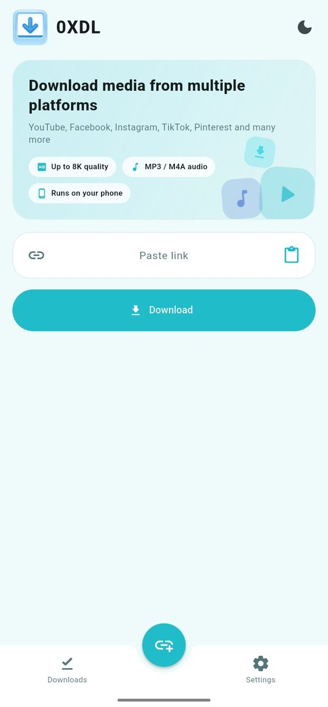
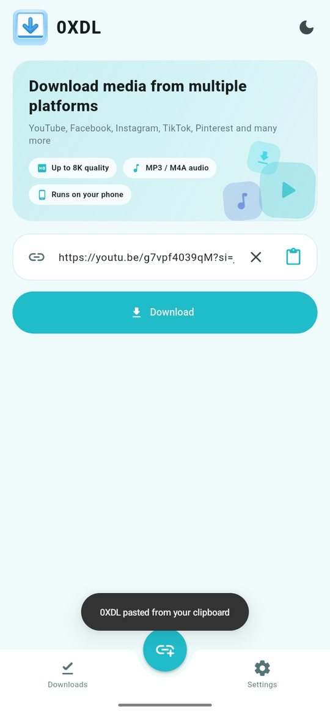
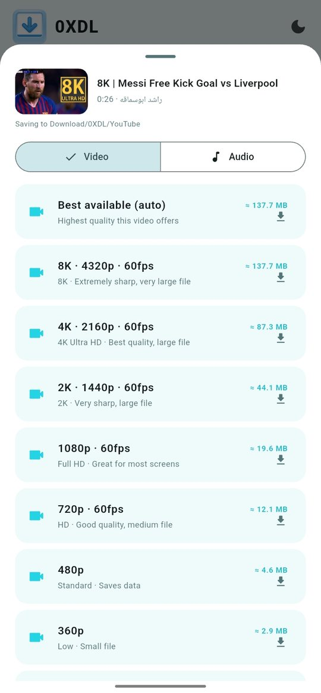
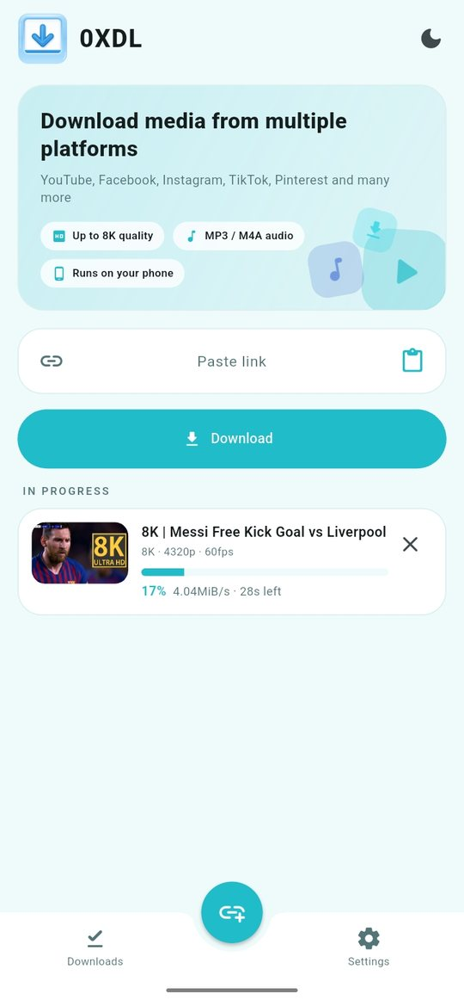
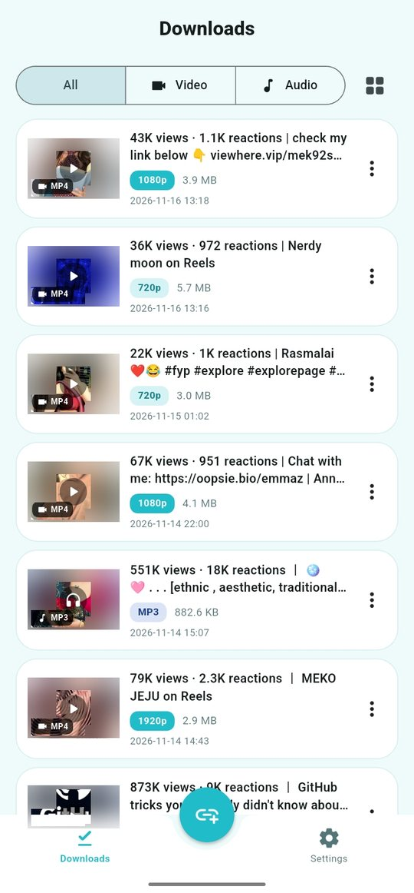
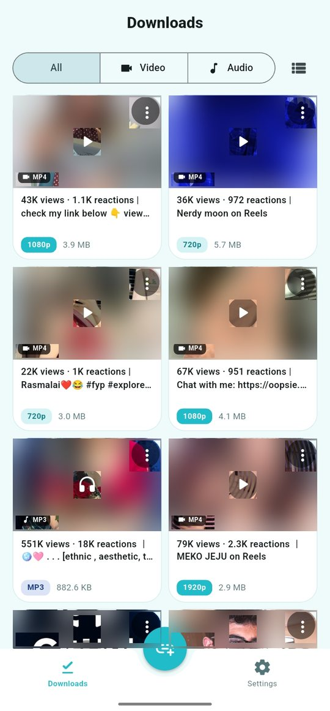
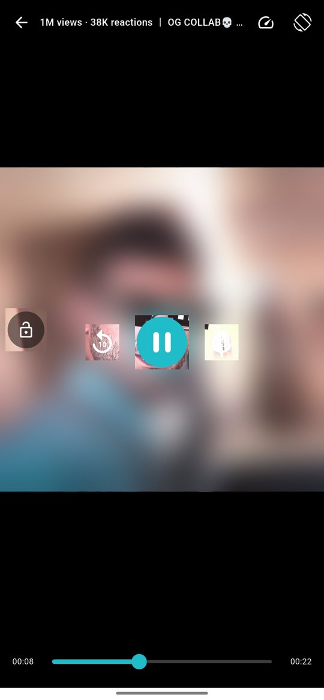
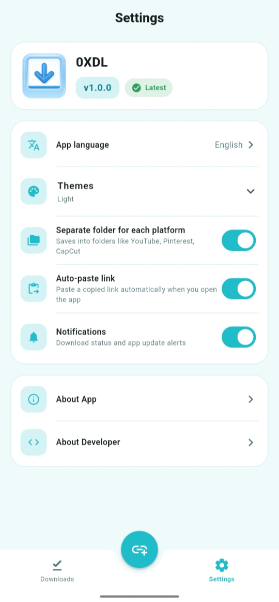
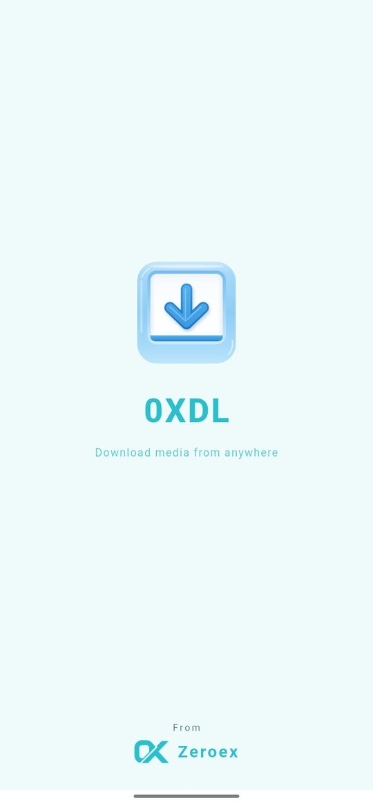
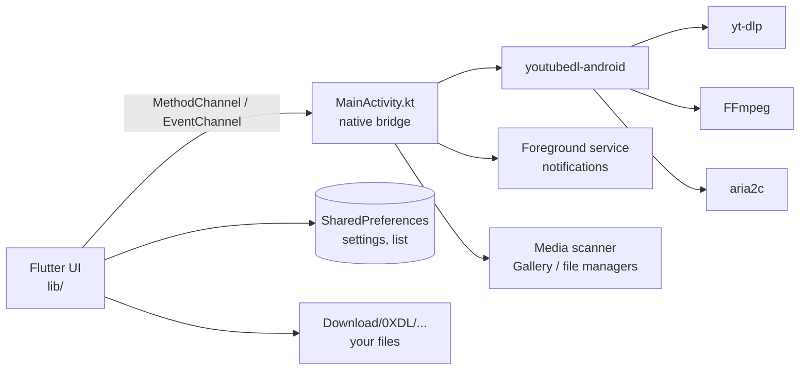

<div align="center">


# 0XDL

**Download media from multiple platforms.**<br>
Free, open-source Android app. Video up to 8K, audio, built-in player. Everything runs on your phone.

[](https://github.com/Zeroex-0X/0XDL/releases/latest)
[](https://github.com/Zeroex-0X/0XDL/releases)
[](LICENSE)
[](#install)
[](https://flutter.dev)

[**Download**](https://github.com/Zeroex-0X/0XDL/releases/latest) &nbsp;・&nbsp; [**Website**](https://zeroex-0x.github.io/0XDL/) &nbsp;・&nbsp; [**Support**](https://zeroex-0x.github.io/support.html) &nbsp;・&nbsp; [**Telegram**](https://t.me/zeroex_0x)

</div>

---

## Contents

[Features](#features) ・ [Screenshots](#screenshots) ・ [Install](#install) ・ [Supported sites](#supported-sites) ・ [How it works](#how-it-works) ・ [Project structure](#project-structure) ・ [Build and release](#build-and-release) ・ [Permissions](#permissions) ・ [Privacy](#privacy) ・ [FAQ](#faq) ・ [Credits](#credits) ・ [Disclaimer](#disclaimer) ・ [License](#license)

## Features

| | |
|---|---|
| **Every quality** | 8K, 4K, 2K, 1080p… whatever the video offers, each with an estimated size and a plain-language note (“Full HD ・ Great for most screens”). |
| **Audio** | MP3, M4A or Opus with the cover image and tags embedded. |
| **Built-in player** | Tap to show controls ・ double-tap ±10 s ・ hold the right side for **2× speed** ・ swipe left for **brightness**, right for **volume** ・ **screen lock**. |
| **Smart folders** | Saved in `Download/0XDL/<Platform>/` (YouTube, Pinterest, CapCut… or `Other`). Switchable in Settings. Files show up in Gallery and file managers immediately. |
| **Downloads manager** | List or grid view, Video / Audio filter, quality badges, rename, share, details, open the source link, delete (optionally with the file). |
| **Survives reinstalls** | The list, source links and thumbnails are rebuilt from your files after reinstalling. |
| **Live notifications** | Progress, speed and time left with the app icon and the video thumbnail, even with the screen off. |
| **Self-updating engine** | The downloader engine updates itself in the background. |
| **In-app updates** | New version popup (update / remind me later / skip) and one-tap install. |
| **Auto-paste** | Copied links appear in the box when you open the app (can be turned off). |
| **Personal** | Day / night mode, 6 accent colours and 6 languages: English, �1�0�1�8�1�8�1�6�1�8, �1�5�1�1�1�8�1�5�1�6�1�2, �1�9�1�8�1�7�1�9�1�0�1�4�1�1, Espa�0�9ol, Bahasa Indonesia. |
| **Private** | No account, no server, no analytics. |

## Screenshots

<div align="center">

| Home | Auto-paste | Choose quality |
|:---:|:---:|:---:|
|  |  |  |

| Live progress | Downloads (list) | Downloads (grid) |
|:---:|:---:|:---:|
|  |  |  |

| Built-in player | Settings | Splash |
|:---:|:---:|:---:|
|  |  |  |

</div>

## Install

1. Open the [**latest release**](https://github.com/Zeroex-0X/0XDL/releases/latest) (or the [website](https://zeroex-0x.github.io/0XDL/)).
2. Download the APK for your phone:

   | File | For |
   |---|---|
   | `0XDL-vX.Y.Z-arm64-v8a.apk` | **Almost every modern phone** (start here) |
   | `0XDL-vX.Y.Z-armeabi-v7a.apk` | Older 32-bit phones |
   | `0XDL-vX.Y.Z-x86_64.apk` | Emulators / some Chromebooks |

3. Open the file and allow **Install unknown apps** when Android asks.
4. Open 0XDL, allow storage and notifications, paste a link, tap **Download**.

Requires **Android 7.0 (API 24)** or newer. Updates can be installed from inside the app (Settings → the version card).

## Supported sites

YouTube, Facebook, Instagram, TikTok, Pinterest, CapCut, X / Twitter, Vimeo, Reddit, SoundCloud, Dailymotion… and every other site supported by [yt-dlp](https://github.com/yt-dlp/yt-dlp/blob/master/supportedsites.md). Private, login-only or DRM-protected content cannot be downloaded.

## How it works



- The UI is written in **Flutter** (Provider for state).
- A small **Kotlin bridge** runs yt-dlp, FFmpeg and aria2c *locally on the phone* and streams progress back to the UI.
- Every file carries its source link in its tags (`--embed-metadata`); that is how the list is rebuilt after a reinstall.
- A foreground service keeps downloads (and in-app updates) alive with the screen off.

## Project structure

The `android/` folder is **not** committed: CI generates it with `flutter create` and then applies `android_overrides/` and `scripts/patch_android.py`.

```text
0XDL/
├── .github/
│   └── workflows/
│       └── release.yml                       # CI: builds signed APKs and publishes a GitHub release on every v* tag
├── android_overrides/
│   ├── res/                                  # Launcher icons, launch theme and notification icons
│   ├── DownloadForegroundService.kt          # Foreground service + download notifications (app icon & thumbnail)
│   ├── MainActivity.kt                       # Native bridge: yt-dlp / ffmpeg / aria2c, progress, media scan, brightness & volume
│   └── UpdateCheckWorker.kt                  # Background check for new app versions (WorkManager)
├── assets/
│   └── icon/                                 # App logo, Zeroex mark and brand icons
├── docs/
│   ├── assets/                               # Website images (icon, banner, social preview)
│   ├── screenshots/                          # Screenshots used by the website and this README
│   └── index.html                            # Project website (GitHub Pages)
├── lib/
│   ├── core/
│   │   ├── l10n.dart                         # Settings model and English / Bangla strings
│   │   ├── l10n_extra.dart                   # Hindi, Arabic, Spanish and Indonesian strings
│   │   ├── links.dart                        # App version, update repo and developer links
│   │   ├── platform_util.dart                # URL checks, platform folder names, friendly errors
│   │   └── theme.dart                        # Day / night palettes and the 6 accent colours
│   ├── models/
│   │   └── models.dart                       # Data classes (formats, downloads, history)
│   ├── providers/
│   │   ├── download_provider.dart            # Downloads, history, restore, rename
│   │   └── update_provider.dart              # App update state, in-app update download
│   ├── screens/
│   │   ├── downloads_page.dart               # History: filter, list / grid
│   │   ├── home_page.dart                    # Paste box, intro card, running downloads
│   │   ├── main_shell.dart                   # Curved bottom bar, start-up dialogs
│   │   ├── player_page.dart                  # Built-in video / audio player
│   │   ├── settings_page.dart                # Settings and update card
│   │   └── splash_screen.dart                # Splash screen
│   ├── services/
│   │   ├── history_service.dart              # History storage and folder scan
│   │   ├── meta_reader.dart                  # Reads the source link stored inside a file
│   │   ├── option_builder.dart               # Builds quality options and yt-dlp arguments
│   │   ├── permission_service.dart           # Storage / notification permissions
│   │   ├── player_native.dart                # Screen brightness and volume for the player
│   │   ├── prefs_service.dart                # Small saved flags
│   │   ├── support_prompt.dart               # When to show the support request
│   │   ├── update_service.dart               # GitHub release lookup and APK cleanup
│   │   └── ytdlp_service.dart                # Flutter side of the native engine bridge
│   ├── widgets/                              # Reusable UI: dialogs, sheets, cards, thumbnails
│   └── main.dart                             # App entry point, theme and providers
├── scripts/
│   └── patch_android.py                      # Patches the generated Android project (manifest, Gradle, signing)
├── .gitignore
├── LICENSE
├── pubspec.yaml
└── README.md                                 
```

## Build and release

Releases are built by GitHub Actions ([`release.yml`](.github/workflows/release.yml)), no local Android setup needed.

1. **Create a signing key** (once, keep it safe, you need the *same* key for every update):

   ```bash
   keytool -genkey -v -keystore oxdl-release.jks -keyalg RSA -keysize 2048 -validity 10000 -alias oxdl
   base64 -w0 oxdl-release.jks        # copy the output
   ```

2. In the repository go to **Settings → Secrets and variables → Actions** and add:

   | Secret | Value |
   |---|---|
   | `KEYSTORE_BASE64` | the base64 text from above |
   | `KEY_ALIAS` | `oxdl` |
   | `STORE_PASSWORD` | keystore password |
   | `KEY_PASSWORD` | key password |

3. **Publish a version** with a tag that looks like `v1.0.0`:

   ```bash
   git tag v1.0.0
   git push origin v1.0.0
   ```

   The tag becomes the app version and the release gets three APKs named `0XDL-v1.0.0-<abi>.apk`. Without the secrets the workflow still builds, but signs with the debug key.

4. **Website:** *Settings → Pages → Deploy from a branch → `main` / `/docs`*. The site is then live at `https://<user>.github.io/0XDL/`.

The app checks **this repository's** latest release for updates (the repository name is injected at build time), so forks work without code changes.

## Permissions

| Permission | Why |
|---|---|
| Internet | Download media, check for updates |
| All files access (`MANAGE_EXTERNAL_STORAGE`) | Save into `Download/0XDL` and restore your list after a reinstall |
| Notifications | Download progress and update alerts |
| Foreground service | Keep downloads running with the screen off |
| Install unknown apps | Only for the in-app update |

## Privacy

0XDL has no account system, no server of its own and no analytics or ads. Links you paste are processed on your phone by yt-dlp and sent only to the site you download from. The app contacts GitHub to look for new versions and to update the downloader engine.

## FAQ

**A site stopped working.** The engine updates itself; open the app and retry after a moment. If it keeps failing, please [open an issue](https://github.com/Zeroex-0X/0XDL/issues) with the link (if public) and the message you see.

**“App not installed”.** You probably have a build signed with a different key. Uninstall the old one first, then install again.

**Where is my list after reinstalling?** Open Downloads and pull down to refresh (or tap *Find my downloads*). Files must still be in `Download/0XDL`.

**Is it safe?** The full source is here. Release APKs are built by GitHub Actions from this code.

## Credits

0XDL stands on the shoulders of these projects. Huge thanks to their authors and contributors.

| Project | Role | License |
|---|---|---|
| [**yt-dlp**](https://github.com/yt-dlp/yt-dlp) | The download engine | Unlicense |
| [**youtubedl-android**](https://github.com/yausername/youtubedl-android) by *yausername* | Runs yt-dlp on Android | GPL-3.0 |
| [**youtubedl-android (JunkFood02 fork)**](https://github.com/JunkFood02/youtubedl-android) | The maintained library used by this app | GPL-3.0 |
| [**Seal**](https://github.com/JunkFood02/Seal) by *JunkFood02* | Inspiration and reference for integrating yt-dlp on Android | GPL-3.0 |
| [**FFmpeg**](https://ffmpeg.org) | Merging video + audio, converting, embedding tags | LGPL / GPL |
| [**aria2**](https://github.com/aria2/aria2) | Optional fast multi-connection downloads | GPL-2.0 |
| [**Flutter**](https://flutter.dev) | UI framework | BSD-3 |
| [provider](https://pub.dev/packages/provider) ・ [video_player](https://pub.dev/packages/video_player) ・ [share_plus](https://pub.dev/packages/share_plus) ・ [open_filex](https://pub.dev/packages/open_filex) ・ [permission_handler](https://pub.dev/packages/permission_handler) ・ [path_provider](https://pub.dev/packages/path_provider) ・ [shared_preferences](https://pub.dev/packages/shared_preferences) ・ [url_launcher](https://pub.dev/packages/url_launcher) | Flutter packages | BSD / MIT |
| Brand icons (Telegram, Facebook, GitHub) from [Simple Icons](https://simpleicons.org) | About Developer sheet | CC0 |

## Disclaimer

0XDL is a tool. Download only content you own or have permission to download, and respect the terms of the sites you use and the copyright of creators. The developer is not responsible for misuse. 0XDL is not affiliated with YouTube, Facebook, Instagram, TikTok, Pinterest, CapCut or any other service.

## License

Released under the **GNU General Public License v3.0**, see [LICENSE](LICENSE). The GPL applies because the app bundles GPL-licensed components (youtubedl-android, FFmpeg, aria2).

---

<div align="center">

**From Zeroex**

[Website](https://zeroex-0x.github.io/) ・ [Support](https://zeroex-0x.github.io/support.html) ・ [Telegram](https://t.me/zeroex_0x) ・ [Facebook](https://www.facebook.com/zeroex.0X) ・ [GitHub](https://github.com/Zeroex-0X)

</div>
